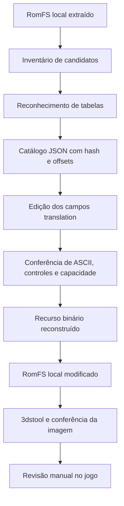

# Arquitetura

## Fluxo de trabalho

O repositório fornece as ferramentas. As entradas e saídas com dados do jogo
ficam no computador de quem as fornece, fora do conteúdo versionado.

## Componentes

1. `localization_inventory`: busca sequências legíveis e candidatos LE32.
2. `full_text_tool`: reconhece tabelas, exporta registros e reconstrói os formatos.
3. `inspect_tga` e `nw4c_rgba8`: inspecionam a prévia e a textura usada pela GPU.
4. `repack_soul_hackers`: coordena o 3dstool e compara hashes dos resultados.

Não há API de tradução, serviço remoto ou dependência de bibliotecas Python de
terceiros no código publicado. O exemplo sintético não exige 3dstool.

## Contrato do catálogo

Cada recurso registra hash e tamanho de origem. As tabelas registram sua posição,
capacidade, tipo de ponteiro, endianness e registros. Cada registro separa:

- `text`: sequência de ASCII imprimível, com `source` e `translation`;
- `control`: bytes de comandos reconhecidos pelo tokenizador;
- `raw`: bytes preservados sem interpretação de texto.

O construtor reexporta a origem e compara metadados e tokens antes de aceitar as
traduções. `translation = null` mantém o texto original; `translation = ""`
remove somente o trecho de texto, preservando os demais tokens.

## Alocação fixa

Uma mensagem traduzida pode mudar de tamanho. O construtor recalcula os ponteiros
relativos dentro da tabela, mantém sua posição absoluta e preenche a sobra com
zeros. Se a tabela exceder a capacidade original, a reconstrução é rejeitada.
Não há realocação global nem alteração automática do executável.

## Conferência e observação

Hashes, offsets e capacidade são propriedades verificáveis nos arquivos.
Largura visual, tempo de exibição, contexto da tradução e comportamento durante
o jogo exigem observação no emulador ou hardware. Uma compilação aceita não
comprova que o jogo inteiro esteja traduzido ou livre de falhas.
